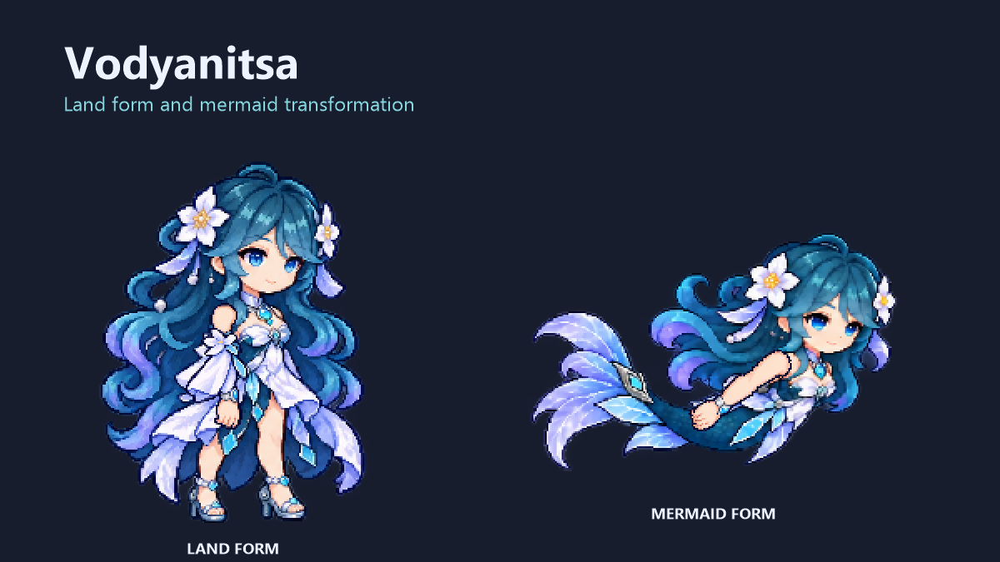

# Vodyanitsa · 沃雅妮莎



[下载 v1.0.0](https://github.com/ifgifg/Vodyanitsa/releases/tag/v1.0.0) · [报告问题](https://github.com/ifgifg/Vodyanitsa/issues)

源码仓库 / Source: [ifgifg/Vodyanitsa](https://github.com/ifgifg/Vodyanitsa)

独立的 tModLoader 玩家变身模组。启用后自动显示为沃雅妮莎，陆地使用双腿形态，普通水中使用鱼尾形态并可持续自由游泳；无需时装、饰品、药水或指令。

**Version 1.0.0.** Automatic player appearance with land and mermaid forms, directional swimming and underwater breathing. This is a fan-made 2D sprite mod, not an official character release or a 3D model.

## 安装与使用

1. 安装 Terraria 与 tModLoader，保存并退出游戏。
2. 将发布的 `Vodyanitsa.tmod` 放入 tModLoader 的 `Mods` 文件夹；可从游戏的模组界面打开该文件夹。Windows 默认位置为“文档\My Games\Terraria\tModLoader\Mods”。
3. 在模组列表启用并重新加载，进入角色即可生效。
4. 普通水中按绑定的左、右、上、下键游泳，跳跃键也可上浮；松开方向后减速悬停。没有额外时间、法力或体力消耗。
5. 在模组配置关闭“启用沃雅妮莎”，或停用模组，即恢复原外观和原版运动。该配置由服务器统一控制。

离水立即恢复原生陆地运动；鱼尾显示保留约 1/6 秒，以减少水面反复切换。熔岩、蜂蜜、微光不触发该游泳与呼吸能力，也不会因此获得伤害免疫。

本模组保留装备属性、背包、武器行为及存档中的原始外貌。碰撞仍由原版处理，不修改碰撞盒、不穿墙、不传送。长尾可以伸出碰撞盒，触墙时玩家本体仍正常停止。坐骑、钩爪、绳索和受控状态不由自由游泳覆盖。

## 与奥黛塔同时安装

- **两者都启用且 Vodyanitsa 的 Enabled 为 true 时，沃雅妮莎优先。** OdetteCharacter 会主动让位并提示，避免两个模组互相隐藏而导致人物消失。
- 使用奥黛塔时，停用 Vodyanitsa，或关闭它的 Enabled 配置；无需删除模组文件。
- 使用沃雅妮莎时，启用 Vodyanitsa 并打开其配置。OdetteCharacter 可以停用，也可以保留并自动让位。
- 原 `OdetteVanity` 是另一个包含旧时装物品的模组，不是依赖。可继续保留，避免已有物品变成未加载物品。

本模组不会自行写入其他模组的配置或启用列表。

## 从源码构建

已验证环境：Windows、Terraria 1.4.4.9、tModLoader 2026.8.3.0、.NET 8 SDK。其他操作系统和 tModLoader 版本未验证；提供的构建脚本使用 Windows PowerShell 路径和目录联接。

保持源码目录名称为 `Vodyanitsa`，在该目录打开 PowerShell：

```powershell
.\build.ps1
# 只编译 C#：


[下载 v1.0.0](https://github.com/ifgifg/Vodyanitsa/releases/tag/v1.0.0) · [报告问题](https://github.com/ifgifg/Vodyanitsa/issues)
.\build.ps1 -CompileOnly
# 使用自己的安装位置和 .NET 8 SDK：


[下载 v1.0.0](https://github.com/ifgifg/Vodyanitsa/releases/tag/v1.0.0) · [报告问题](https://github.com/ifgifg/Vodyanitsa/issues)
.\build.ps1 -TMLPath 'D:\SteamLibrary\steamapps\common\tModLoader' -Dotnet 'C:\Program Files\dotnet\dotnet.exe'
```

脚本默认寻找标准 Steam 安装目录，以及 `%LOCALAPPDATA%\Microsoft\dotnet\dotnet.exe`；不符合本机布局时使用上面的参数。SDK 必须支持 .NET 8，只有游戏附带的运行时不足以编译 C#。

输出位于相邻 `VodyanitsaBuild/release/Vodyanitsa.tmod`。打包使用独立 `build-runtime` 和 `build-save`，不会安装或启用模组，也不读取真实人物/世界。构建需要本机已有的 tModLoader 和依赖，不将它们重新分发到 Git。

## 实现与已知限制

- 八个陆地姿势、八个游泳姿势与四张独立近侧手臂图组成二维角色。切帧、旋转与有限缩放用于对齐原生手持物；这不是完整骨骼动画或原角色全部技能。
- 隐藏装备及其他模组的玩家外观层，但保留原生手持物、手持投射物、坐骑和部分状态效果。依赖独立玩家绘制层的第三方特效可能被覆盖；不保证所有模组武器都具有相同的握持效果。
- 死亡和幽灵保留原版绘制。角色图集保持自身配色，不逐项复刻盔甲染料效果。
- 联机要求服务器与客户端安装本模组，使用原版输入和位置同步，没有新增网络协议。**尚未完成真实双客户端联机实战验证。** 服务端正常加载不能等同于多人功能全部通过。

发布前完成了原生人物绘制、手持物与雨伞握点、透明像素、实际 `Player.Update` 水中控制/呼吸/碰撞/击退、专用服务器加载和目标整合包启动检查。没有把这些检查当作对所有地图、第三方模组或网络条件的全面兼容承诺。

## 源码与许可

`Common/` 为行为与绘制代码，`Assets/Character/` 为运行时图集和锚点数据，`Localization/` 为中英文本地化。[ASSET-CONTRACT.txt](ASSET-CONTRACT.txt) 说明素材格式，[PUBLIC-SOURCE-MANIFEST.txt](PUBLIC-SOURCE-MANIFEST.txt) 列出公开文件。

原创贡献采用 [MIT License](LICENSE)。角色及其他第三方知识产权不在 MIT 授权范围内，见 [THIRD_PARTY_NOTICES.md](THIRD_PARTY_NOTICES.md)。角色图集使用 AI 辅助生成；仓库不包含研究参考图、原版物品纹理导出、游戏二进制、个人配置或存档。
